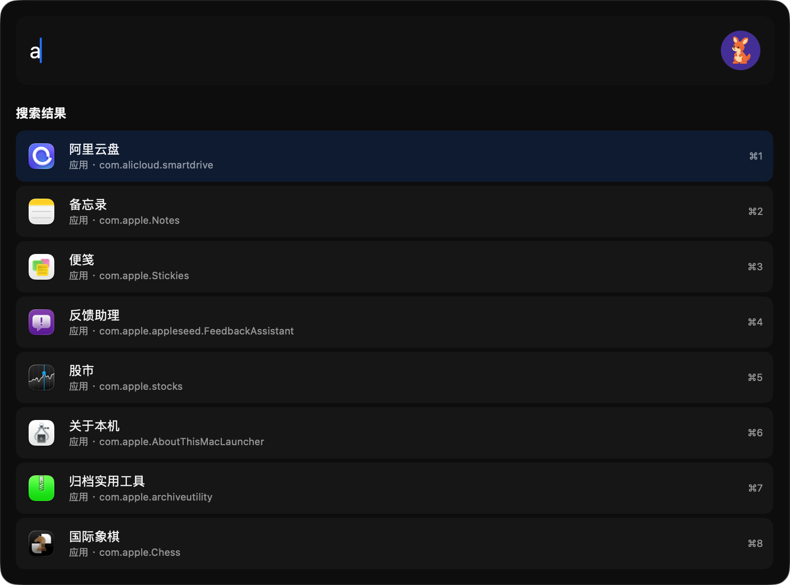

<p align="center"></p>

# Leap

**把你的想法变成 Mac 上的一条命令。**

Leap 是一个可以自由添加插件的开源 macOS 启动器。把常用脚本做成命令，或用你熟悉的 AI 编程工具创建插件。装到本机后，按 `⌥⌘L` 就能搜索并运行。

**无需注册 Leap 账号 · 不设插件安装数量上限 · 插件保存在本机**

[下载 Leap](https://github.com/yuyedaidao/Leap/releases/latest) · [浏览现成插件](https://github.com/yuyedaidao/LeapPlugins)

<p align="center"></p>

## 安装

系统要求：**macOS 26 或更高版本**，搭载 **Apple Silicon** 的 Mac。

### 方式一：下载 DMG

从 [GitHub Releases](https://github.com/yuyedaidao/Leap/releases/latest) 下载 DMG，打开后把 Leap 拖入「应用程序」。

### 方式二：Homebrew

```sh
brew install --cask yuyedaidao/tap/leap
```

### 首次使用

按 `⌥⌘L` 呼出搜索框。输入「备忘录」或 `bwl`，回车即可打开应用；插件命令也可以用同样的方式搜索。

设置里的「关于」页可以检查更新，「通用」页可以开关启动时自动检查更新。

## 开发

### 安装官方 Skill

Leap 提供了官方 Skill `leap-plugin-development`。装进常用的 AI 编程工具（Codex、Claude Code、Cursor 等）后，AI 就能按 Leap 的插件规范写清单、脚本和网页。

#### 命令安装
```sh
npx skills add https://github.com/yuyedaidao/Leap/tree/main/skills/leap-plugin-development
```
#### 让 AI 安装
复制如下内容到你的 AI 对话框，然后执行。
> 安装 Leap 插件开发 Skill https://github.com/yuyedaidao/Leap/tree/main/skills/leap-plugin-development

### 用 Skill 创建插件

装好后直接说想要什么，并指定用这个 Skill：

> 用 `leap-plugin-development` 帮我做一个 Leap 插件 ... 


### 更多资料

- [插件开发指南](Docs/PluginDevelopment.md)
- [官方示例](Examples/Plugins/README.md)
- [构建与发版说明](Docs/Development.md)

## 帮助与反馈

- [搜索规则](Docs/SearchRules.md)
- [隐私说明](Docs/Privacy.md)
- [反馈问题或分享插件想法](https://github.com/yuyedaidao/Leap/issues)

## 许可证

[MIT](LICENSE)
