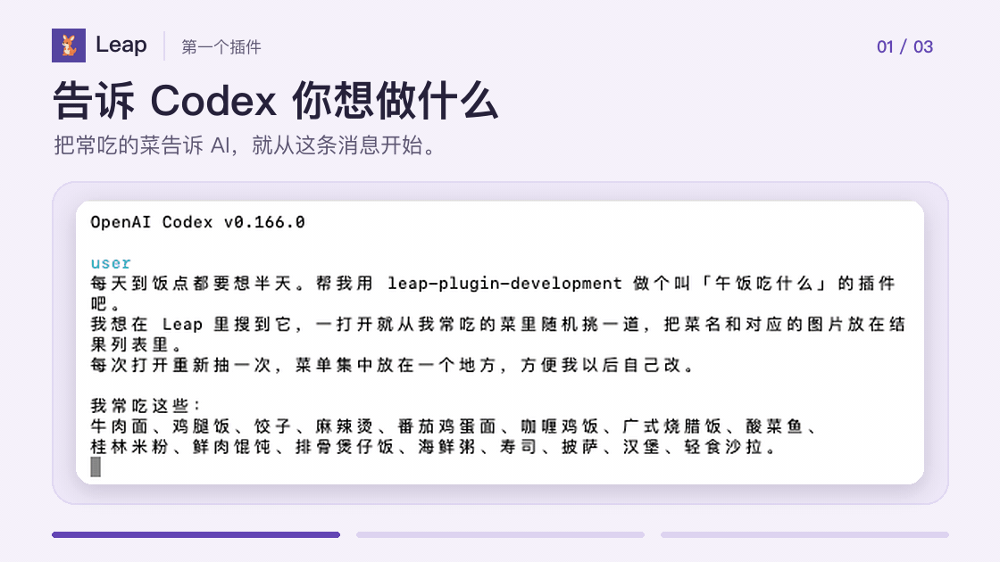

<p align="center"></p>

# Leap

**把你的想法变成 Mac 上的一条命令。**

Leap 是一个可以自由添加插件的开源 macOS 启动器。把常用脚本做成命令，或用你熟悉的 AI 编程工具创建插件。装到本机后，按 `⌥⌘L` 就能搜索并运行。

**无需注册 Leap 账号 · 不设插件安装数量上限 · 插件保存在本机**

[下载 Leap](https://github.com/yuyedaidao/Leap/releases/latest) · [用 AI 创建第一个插件](#用-ai-创建第一个插件)

<p align="center"></p>

## 安装

需要 **macOS 26 或更高版本，以及搭载 Apple Silicon 的 Mac**。

从 [GitHub Releases](https://github.com/yuyedaidao/Leap/releases/latest) 下载 DMG，打开后将 Leap 拖入「应用程序」。也可以用 Homebrew 安装：

```sh
brew install --cask yuyedaidao/tap/leap
```

打开 Leap，按 `⌥⌘L` 呼出搜索框。试着输入「备忘录」或 `bwl`，按回车打开应用。插件命令也可以用同样的方式搜索。

想检查更新，可以打开 Leap 设置里的「关于」页。启动时自动检查更新的开关在「通用」里。

## 为什么用 Leap

- **把常做的事变成命令。** 可以做一个帮你挑午饭、整理文字或打开一组常用文件夹的小工具，再从 Leap 随时打开它。
- **用你已经在用的 AI 来写。** 给 Codex、Claude Code 或 Cursor 描述你想做什么，再让它按你的用法调整插件。
- **插件由你自己管理。** 可以从本地目录或公开 GitHub 仓库的插件目录安装，也可以按需更新、启用和停用。

## 用 AI 创建第一个插件

午饭总在几样东西之间纠结？把常吃的菜告诉 AI，让它做一个「午饭吃什么」插件。每次打开，Leap 会在「今日推荐」里显示随机抽到的菜和对应的图片。



1. 把下面的命令交给你的 AI 编程工具，让它帮你安装 Leap 官方插件开发 Skill。也可以在准备用来存放插件的文件夹里打开终端，运行命令后按提示选择工具。

   ```sh
   npx skills add https://github.com/yuyedaidao/Leap/tree/main/skills/leap-plugin-development
   ```

2. 把下面这段话发给你的 AI 编程工具，菜单可以换成你自己的。

   > 每天到饭点都要想半天。帮我用 `leap-plugin-development` 做个叫「午饭吃什么」的插件吧。我想在 Leap 里搜到它，一打开就从我常吃的菜里随机挑一道，把菜名和对应的图片放在结果列表里。每次打开重新抽一次，菜单集中放在一个地方，方便我以后自己改。生成后告诉我插件目录在哪里。
   >
   > 我常吃这些：牛肉面、鸡腿饭、饺子、麻辣烫、番茄鸡蛋面、咖喱鸡饭、广式烧腊饭、酸菜鱼、桂林米粉、鲜肉馄饨、排骨煲仔饭、海鲜粥、寿司、披萨、汉堡、轻食沙拉。

3. 打开 Leap 设置，在插件页选择「安装插件 → 从本地目录安装」。选择生成的整个插件目录并确认。按 `⌥⌘L` 搜索「午饭吃什么」，回车查看推荐。

## 帮助与反馈

[搜索规则](Docs/SearchRules.md) · [隐私说明](Docs/Privacy.md) · [反馈问题或分享插件想法](https://github.com/yuyedaidao/Leap/issues)

想自己写插件或参与项目维护，可以查看[插件开发指南](Docs/PluginDevelopment.md)、[官方 Skill](skills/leap-plugin-development/)和[构建与发版说明](Docs/Development.md)。

## 许可证

[MIT](LICENSE)
